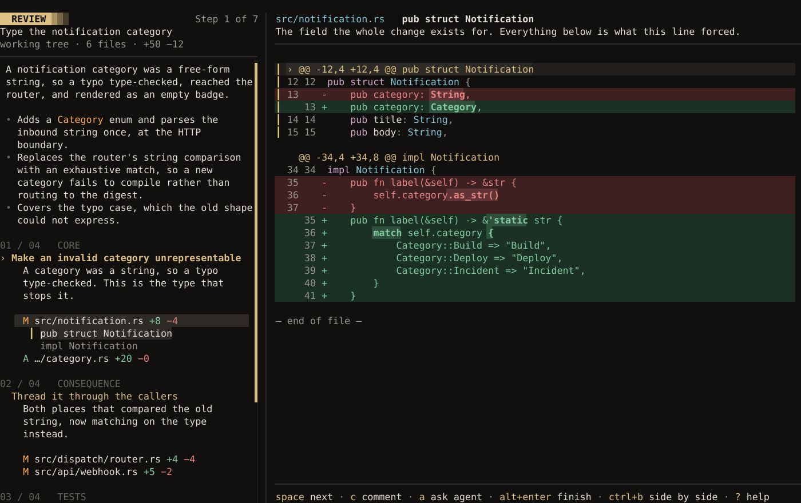

<h1 align="center">
  <picture>
    <source media="(prefers-color-scheme: dark)" srcset="web/src/assets/generated/wordmark-dark.gif">
    
  </picture>
</h1>

luxe is a coding agent for your terminal, written in Rust. It works in your project with the model
you choose, then reads back what it changed as a Guided Review, so you can comment, ask for fixes,
and open the pull request without leaving the terminal.


*One take on Claude Sonnet 5.5, with only the waits cut: it writes `todo overdue` with a test, the
change is read back in three chapters, and the pull request is drafted from the review.*

## What it does

- **Guided Review.** A change is read back to you in chapters, each saying what changed, why, and
  how it was checked, beside the code. Comments go to the agent as work, and finishing turns the
  review into commits, a pull request or a stack of them. It reads someone else's pull request the
  same way.
- **GitHub from the terminal**, through your own `gh`: start from an issue in a worktree of its
  own, see the branch's checks and threads in the dock, answer review threads, merge, restack.
- **Plan, then build.** Plan mode is held in code: it reads, asks, and writes only `PLAN.md`.
  `luxe loop start` then works through the plan phase by phase, and a phase counts only once the
  commands you set pass and, if you ask for one, a reviewer in a fresh context agrees.
- **Tools that beat the shell.** `test` reports each failure with its `file:line`; every edit comes
  back with the errors a language server found in it; `debug` drives a real debugger; `impact`
  names the callers and tests a change reaches. [luxe.dev/tools](https://luxe.dev/tools) measures
  each against the command it replaces.
- **Guardrails that stay on.** Every tool call is allowed, asked about or denied by rules you can
  read. Reading `.env`, wiping your home folder and running as root are refused unless you allow
  them yourself or say `--yolo`, and a repository cannot grant itself trust: its hooks and gate
  commands wait for `--trust-project`, and the servers it brings start only while you are watching.
- **The cache holds.** The system prompt is byte-identical between turns, so a provider's prompt
  cache keeps working. `/cost` shows what was read from it, and `LUXE_WIRE_LOG` plus `luxe wire`
  shows you every byte sent.
- **Scriptable.** `luxe --headless --model provider/id -p "…"` runs one prompt and exits 1 when
  the turn fails, and `--format json` streams its messages, tool calls and each call's token usage.
  With nobody to answer, a call that would ask is allowed; `--on-ask deny` refuses it instead.
  `luxe --rpc` speaks the whole protocol.
- **Extended with files and programs**, never code loaded into luxe: skills, hooks, MCP servers,
  your own `@` sources, and an [RPC protocol](https://luxe.dev/docs/rpc/) for driving luxe from
  your own program.

luxe connects to 24 providers and any OpenAI-compatible endpoint. Sign in with a ChatGPT or GitHub
Copilot subscription or an OpenRouter account, or bring an API key; Anthropic and Google take API
keys only. There is no telemetry: every connection luxe makes is one you asked for or can turn off,
and [the guide lists them](https://luxe.dev/docs/security/#what-luxe-sends-over-the-network).



## Install

```bash
# macOS and Linux
curl -fsSL https://luxe.dev/install.sh | sh

# Homebrew
brew install evanwhittaker/tap/luxe

# Cargo (Rust 1.89 or newer)
cargo install --locked luxe-cli

# Windows (PowerShell)
powershell -c "irm https://luxe.dev/install.ps1 | iex"
```

To update, run `luxe update`. To build from source:

```bash
git clone https://github.com/evanwhittaker/luxe.git
cd luxe
cargo build --release
./target/release/luxe --version
```

luxe runs on Linux, macOS and Windows, in any UTF-8 terminal; on Windows, use Windows Terminal and
install [Git for Windows](https://gitforwindows.org/) so the agent has a POSIX shell. You also need
a model to talk to: an API key or a subscription. Your settings and credentials live in
`~/.config/luxe/` (`%APPDATA%\luxe` on Windows).

Icons come from a [Nerd Font](https://www.nerdfonts.com/) when you have one, in its **Mono** build;
without one, luxe draws plain characters, and every icon has a word beside it. See
[Fonts](https://luxe.dev/docs/install/#fonts).

luxe uses these when they are installed, and works without them:

| | For |
| --- | --- |
| Git | Reviewing changes, and worktrees |
| The GitHub CLI, `gh`, signed in | Issues and pull requests |
| A language server per language | Errors after each edit, definitions and references |
| A debug adapter per language | The `debug` tool |
| [ast-grep](https://ast-grep.github.io) | Search and replace by code structure |

`luxe doctor` checks which of them luxe can use on your machine, and how to install the rest.

## Quickstart

1. **Start in your project, on a branch of its own.**

   ```bash
   cd your-project
   git switch -c my-change
   luxe
   ```

   `luxe --worktree` does the same in a worktree, so your checkout is never touched.

2. **Answer setup.** The first launch asks for a theme, a provider, which tools the agent can use,
   and what luxe opens on. Sign in with a subscription or paste an API key; a key already in your
   environment, such as `ANTHROPIC_API_KEY`, is found on its own. Choose a model when the picker
   opens.

3. **Ask for something.** Type it and press `enter`. Each step the agent takes appears as a card;
   type while it works to steer it, and `esc` stops the turn.

4. **Review it.** Press `ctrl+g`. When `review ready` shows, press it again: `space` steps through
   the change, `c` comments on a line, `a` asks the agent about it.

5. **Ship it.** `alt+enter` finishes the review. Choose **Request fixes** to send your comments,
   or, with the GitHub CLI signed in (`gh auth login`), **Open pull request**, drafted from the
   review.

`luxe -c` picks up your last session. `ctrl+k` opens the Command Palette, `/help` lists every key
on the screen you are on, and `ctrl+c` quits; the session is already saved. The
[Quickstart](https://luxe.dev/docs/quickstart/) walks through the same steps with pictures.


## Documentation

The guide is at [luxe.dev/docs](https://luxe.dev/docs/), and built into luxe for the version you
have: `luxe docs`, `luxe docs hooks`, `luxe docs --search "on_ask"`. Ask the agent how to do
something in luxe and it reads the answer from the same pages.

| To | Read |
| --- | --- |
| Connect a model, or switch between them | [Models and providers](https://luxe.dev/docs/providers/) |
| Find your way around the screen | [The interface](https://luxe.dev/docs/interface/) |
| Find a command or a key, or rebind one | [Commands and keys](https://luxe.dev/docs/commands/) |
| Review what the agent changed | [Guided Review](https://luxe.dev/docs/guided-review/) |
| Work from an issue, open or merge a pull request | [Git and GitHub](https://luxe.dev/docs/github/) |
| Let the agent work through a plan on its own | [Autonomous runs](https://luxe.dev/docs/loop/) |
| See what the agent can use | [Tools](https://luxe.dev/docs/tools/) |
| Give the agent your project's conventions | [Project context](https://luxe.dev/docs/project-context/) |
| Change the theme, keys or statusline | [Configuration](https://luxe.dev/docs/configuration/) |
| Control what the agent may do | [Security and permissions](https://luxe.dev/docs/security/) |
| Add tools, skills, hooks or your own front end | [Extending luxe](https://luxe.dev/docs/extending/) |
| Look up a flag or an environment variable | [Command line](https://luxe.dev/docs/cli/), [Environment variables](https://luxe.dev/docs/environment/) |
| Fix something that is not working | [Troubleshooting](https://luxe.dev/docs/troubleshooting/) |

Every page is also plain markdown in [`docs/guide/`](docs/guide/), and
[`llms.txt`](https://luxe.dev/llms.txt) lists them for an agent.

## Contributing

[`CONTRIBUTING.md`](CONTRIBUTING.md) has the gate, the architecture, the Windows checks and how
the site and the demos are made; [`AGENTS.md`](AGENTS.md) has the rules an agent working here holds
to. Problems and questions go to [GitHub issues](https://github.com/evanwhittaker/luxe/issues).

luxe is built with AI assistance, much of it luxe working on itself. Every change still passes the
full test suite and CI before it merges, and its maintainer decides what does. If AI helped with
yours, [say so](CONTRIBUTING.md#ai-assistance).

luxe draws on Pi, by earendil-works, and on OpenCode, and on the unidirectional data flow of Elm
and Ratatui.

## License

Licensed under either of [MIT](LICENSE-MIT) or [Apache-2.0](LICENSE-APACHE), at your option. Unless
you say otherwise, a contribution you submit is licensed the same way, without further terms.
