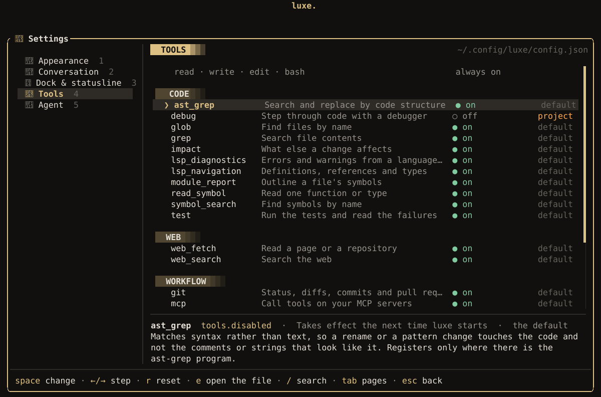

luxe works with no configuration. Everything here is optional, and most of it can be set from inside
luxe: **Configuration** (on the start screen, or `/config`) signs you in and opens these files in
your editor, [`/settings`](#settings) changes the settings you use most, `/theme` sets the theme,
and `/model` the model.

## Files

Your own files live in `~/.config/luxe/` (`%APPDATA%\luxe` on Windows). A project can have its own
in `.luxe/` at its root.

| File | Holds | In a project |
| --- | --- | --- |
| `config.json` | Appearance, behavior, and the settings on this page | `.luxe/config.json`, over yours |
| `keybindings.json` | Your keys; see [Commands and keys](commands.md#rebind-keys) | `.luxe/keybindings.json`, over yours |
| `models.json` | Model and provider settings; see [Custom providers](custom-providers.md) | |
| `auth.json` | Credentials; see [Models and providers](providers.md#where-credentials-are-kept) | |
| `permissions.json` | What the agent may do; see [Security](security.md) | `.luxe/permissions.json`, which can only tighten yours |
| `hooks.json` | Commands run at points in a turn; see [Hooks](hooks.md) | `.luxe/hooks.json`, only with `--trust-project` |
| `mcp.json` | MCP servers; see [MCP](mcp.md) | `.luxe/mcp.json` or `.mcp.json` |
| `lsp-servers.json` | Language servers; see [Tools](tools.md#add-a-language-server) | |
| `debug-adapters.json` | Debug adapters; see [Tools](tools.md#debugger) | |
| `agents.md` | Instructions for every project; see [Project context](project-context.md) | `AGENTS.md` |
| `themes/` | Your own themes; see [Appearance](appearance.md#make-a-theme) | |
| `skills/` | Your own skills; see [Skills](skills.md) | `.luxe/skills/` or `.agents/skills/` |

`LUXE_CONFIG_DIR` moves the whole directory, and every file in it.

### What a project cannot change

A project's `.luxe/config.json` overrides yours key by key, with a few exceptions. These run
programs, reach the network, or decide what a repository is trusted with, so luxe reads them from
your own config only:

- `launchers` and `mentions`, which run programs
- `update`, and `github.refresh_secs`
- `lsp.project_servers`
- `agent.on_ask`, which a project can set to `deny` but not to `allow`
- `agent.cache_warming`, which a project can turn down but not up, since it spends your money

Project `gate.commands`, `dock.custom` and `statusline.custom` also run programs. luxe ignores them
and warns unless you start with `--trust-project`. With trust, a nonempty project `gate.commands`
list replaces your global list. Otherwise, the loop uses your global commands. Move any of them to
your own config if you don't want to trust the project.

### Editing

`luxe init` asks the first run's questions again (a theme, a provider, the tools, and the start
screen) and writes the answers to `config.json`, changing only those keys. It also writes a
`config.schema.json` beside it so your editor can complete and check every key. `--defaults` writes
a file that chooses nothing, without asking, and so does a run with no terminal; with a
`config.json` already there, either one needs `--force`, which removes the old file first. luxe ignores a key it does
not know, so an old config always loads on a newer luxe; check the spelling if a setting seems to
do nothing.

`/reload` (`ctrl+shift+r`) applies changes to `config.json` and `keybindings.json` without
restarting.

## Settings



`/settings`, or **Settings** in **Configuration**, shows the settings you are most likely to change
as controls, on five pages: Appearance, Conversation, Dock & statusline, Tools, and Agent. Each
change writes one key to your `config.json` and leaves the rest of the file as it was.

| To | Key |
| --- | --- |
| Choose a setting | `↑` / `↓` |
| Turn it on or off, or step to the next choice | `space`, `enter` or `→` |
| Step back a choice | `←` |
| Remove it from your file, so the default applies | `r` |
| Open `config.json` in your editor | `e` |
| Search every page | `/` |
| Change page | `tab`, or `1` to `5` |

Each value says where it comes from: `default`, `global` (your `config.json`), or `project` (this
project's `.luxe/config.json`, which wins over yours, so it is changed there). Most settings take
effect at once; the rest say they take effect the next time luxe starts. That includes the Tools
page, because the tools the agent is offered are fixed for a run. In a window too small for the
panel, it says so instead, and only `esc` works until the window fits.

## Behavior

### Notifications

```json title="~/.config/luxe/config.json"
{ "notifications": true, "bell": false }
```

`notifications` sends a desktop notification while the terminal is in the background, when a turn
finishes or fails, a tool call waits for your approval, the agent asks you a question, or a Guided
Review finishes writing its guide. To pick some of those, list them:

```json title="~/.config/luxe/config.json"
{ "notifications": ["permission", "question"] }
```

| Name | When |
| --- | --- |
| `turn` | A turn finished or failed |
| `permission` | A tool call is waiting for your approval |
| `question` | The agent asked you something |
| `review` | A Guided Review finished writing its guide |

`bell` rings the terminal bell at each of those moments. Both are off by default. Many terminals
turn a bell into a request for the window manager's attention, which can pull focus from what you
are doing.

The notification goes through your terminal, as an escape sequence it turns into a desktop
notification, so it works over ssh and needs nothing installed. Ghostty, iTerm2, kitty, WezTerm,
Warp and foot show them; luxe recognizes those and sends nothing to a terminal it does not know. If
yours shows them and luxe does not recognize it, name the sequence: `"notification_method": "osc9"`
(the common one) or `"osc777"`. Inside tmux, add `set -g allow-passthrough on` to your tmux
configuration. Your terminal may also have to be allowed to send notifications in your system's
settings.

### herdr

Inside a [herdr](https://herdr.dev) pane, luxe tells herdr whether it is working, idle, or waiting
on you, and why: `Approve bash`, or the question it asked. herdr shows that in its sidebar, raises
its own notification when luxe finishes or needs you (set in herdr's `[ui.toast]`), and reports it
to `herdr agent wait`. After a herdr restart, the pane reopens the same session with
`luxe --resume`. luxe sends no escape-sequence notifications inside herdr, because herdr keeps
them for itself.

[Recipes](recipes.md#luxe-colors-in-herdr) has a luxe palette for herdr's theme.

This is local to your machine and on by default. Outside herdr nothing is sent.
`LUXE_HERDR=0` in the environment stops the reports, and so does the config:

```json title="~/.config/luxe/config.json"
{ "herdr": false }
```

### Joining a session

A running luxe lets another program on this machine join its session: `luxe join`, a script, or
whatever you build on [the RPC protocol](rpc.md#join-a-running-session). Only your user account can
connect, and nothing listens on the network. To turn it off:

```json title="~/.config/luxe/config.json"
{ "joinable": false }
```

`LUXE_JOINABLE=0` turns it off for one run. A project's config can turn it off too, but can't turn
it back on once yours has.

### Updates

Once a day, luxe checks whether a newer release exists, and when one does the start screen says
*Update available · /update*. The check sends nothing about you or your machine; the comparison
happens locally.

`/update`, or `luxe update` in a shell, updates luxe with the command for however you installed
it, showing each one before it runs:

| Installed with | `luxe update` runs |
| --- | --- |
| The install script | The install script again, downloaded from the new release |
| Homebrew | `brew update`, then `brew upgrade luxe` |
| Cargo, from crates.io | `cargo install --locked --force luxe-cli` |
| Cargo, from a checkout or fork (`--path`, `--git`) | Nothing. It tells you to pull and rebuild, so your build isn't replaced |

luxe never replaces its own program; whatever installed it does. For the install script, that's
the new release's copy of the same script, run into the folder the first install used. Its
temporary files go in a folder luxe deletes afterwards, and what it prints is saved to
`update.log` in luxe's logs folder (`~/.local/state/luxe/logs`, or `%LOCALAPPDATA%\luxe\logs` on
Windows). A copy your system's package manager owns is left to it, and a downloaded archive
points you at the releases page. On Windows, a running program can't be overwritten, so luxe
first renames itself to `luxe.exe.old`, and the next launch deletes it.
Afterwards it checks that the `luxe` your shell finds is the new version, and says so if another
copy earlier on your `PATH` is in the way. `luxe update --check` only reports.

To stop the daily check:

```json title="~/.config/luxe/config.json"
{ "update": { "check": false } }
```

`LUXE_UPDATE_CHECK=0` turns it off as well. `luxe update` still checks when you run it.

### Launchers

A launcher gives a key to a program that takes over the terminal and gives it back, such as gh-dash
or lazygit:

```json title="~/.config/luxe/config.json"
{
  "launchers": [
    { "key": "alt+g", "command": "gh-dash" },
    { "key": "ctrl+alt+l", "command": "lazygit" }
  ]
}
```

luxe keeps running underneath and redraws when the program exits. Text the program writes to the
file named by `$LUXE_HANDOFF` is put in the composer, so a gh-dash command can send
`#123 look at this` to luxe. A launcher's key wins over any other binding.

## Reference

Every key in `config.json`, with its default.

| Key | Default | Does |
| --- | --- | --- |
| `theme` | your Omarchy theme, else `luxe` | The theme; see [Appearance](appearance.md#themes) |
| `colors` | | Single color overrides; see [Appearance](appearance.md#change-a-few-colors) |
| `glyphs` | `auto` | Which icons to draw; see [Appearance](appearance.md#icons-and-fonts) |
| `images` | `auto` | How images are drawn; see [Appearance](appearance.md#images) |
| `mouse` | `true` | Capture the mouse; see [The interface](interface.md#mouse-and-clipboard) |
| `dashboard` | `true` | Open on the [start screen](interface.md#the-start-screen). `false` skips it; `{ "style": "minimal" }` shows the prompt alone. |
| `banner_animation` | `true` | The shine across the start screen's logotype |
| `show_key_hints` | `true` | The key hint beside messages waiting for a turn |
| `notifications` | `false` | Desktop notifications: `true`, or a list of moments; see [Notifications](#notifications) |
| `notification_method` | `auto` | `auto`, `osc9` or `osc777` |
| `bell` | `false` | Terminal bell when a turn ends or something waits on you |
| `herdr` | `true` | Report the agent's state to herdr; see [herdr](#herdr) |
| `joinable` | `true` | Let another program on this machine join a running session; see [Joining a session](#joining-a-session) |
| `statusline.visibility` | `auto` | `auto`, `shown` or `hidden`; see [Appearance](appearance.md#statusline) |
| `statusline.style` | `slab` | `slab` or `flat` |
| `statusline.left` | `["project", "branch", "pr", "todo", "changes"]` | Modules on the left, including your own |
| `statusline.right` | `["context", "cost", "tokens", "thinking", "model"]` | Modules on the right, including your own |
| `statusline.thinking_colors` | `false` | Color the thinking level |
| `statusline.custom` | none | Modules drawn from your own programs, by name; see [Appearance](appearance.md#your-own-modules) |
| `dock.mode` | `auto` | `auto`, `shown` or `hidden`; see [The interface](interface.md#the-dock) |
| `dock.position` | `left` | `left` or `right` |
| `dock.sections` | every section | Which dock sections show, in order; see [The interface](interface.md#choose-the-sections) |
| `dock.custom` | none | Dock sections drawn from your own programs, by name; see [The interface](interface.md#your-own-sections) |
| `conversation.alignment` | `full` | `full`, `left` or `center`; see [Appearance](appearance.md#the-conversation) |
| `conversation.prose_max_width` | `120` | Text width under `left` or `center` |
| `conversation.wide_block_max_width` | `140` | Code and table width under `left` or `center` |
| `conversation.growth` | `bottom` | `bottom` or `top` |
| `conversation.thinking` | `shown` | `shown`, `collapsed` or `hidden` |
| `conversation.tool_runs` | `fold` | `fold` or `cards` |
| `conversation.tool_details` | `errors` | `errors`, `all` or `collapsed` |
| `conversation.stream_reveal` | `smooth` | `smooth` or `off` |
| `conversation.activity_bar` | `bars` | `bars`, `dots` or `off` |
| `conversation.scroll_lines` | `3` | Lines per wheel notch, 1 to 20 |
| `conversation.image_max_rows` | `24` | Tallest image, in rows |
| `diff.layout` | `auto` | `auto`, `split` or `unified`; see [Appearance](appearance.md#diffs) |
| `diff.word_wrap` | `false` | Wrap long lines in Guided Review |
| `review.exclude` | `[]` | Files every review leaves out; see [Guided Review](guided-review.md#what-needs-you) |
| `review.context_files` | `[]` | Extra files a review reads for what the change was for, beside `PLAN.md` and `AGENTS.md` |
| `tools.disabled` | `[]` | Tools to turn off; see [Tools](tools.md#turn-tools-off) |
| `tools.format_on_save` | `true` | Format each file the agent changes; see [Tools](tools.md#format-on-save) |
| `tools.clone_repositories` | `true` | Clone a GitHub repository `web_fetch` is given; see [Tools](tools.md#github-repositories) |
| `lsp.project_servers` | `auto` | `auto`, `always` or `never`; see [Tools](tools.md#a-server-the-project-installed) |
| `compaction.auto` | `true` | Summarize when the window fills; see [Sessions and context](sessions.md#compaction) |
| `compaction.at` | `0.9` | How full before summarizing |
| `compaction.keep_recent` | `20000` | Tokens kept word for word |
| `compaction.reserve` | `20000` | Tokens held back for the reply |
| `compaction.prune` | `true` | Replace old tool output first |
| `compaction.summarizer` | the session's model | The model that writes the summary |
| `agent.default_mode` | `build` | The mode a session starts in: `build` or `plan`; see [Plan, then build](agent.md#plan-then-build) |
| `plan.files` | `["PLAN.md"]` | Files or globs plan mode may write; the first plain file gets the plan, or a file matching the first glob |
| `plan.model` | the session's model | Plan mode's model, as `provider/id`; switching to it re-reads the conversation at full price |
| `plan.thinking` | the session's | Plan mode's thinking level |
| `reviewer.model` | the session's model | The model `/review` and the loop's gate ask; see [A second opinion](agent.md#a-second-opinion) |
| `reviewer.thinking` | the session's | The reviewer's thinking level |
| `reviewer.tools` | read-only tools | Tools a review may call; whatever you list, a review changes nothing |
| `agent.remember_model` | `true` | Start on the model you last chose |
| `agent.max_tool_iterations` | none | Most rounds of tool calls in one turn |
| `agent.on_ask` | `allow` | What a permission prompt becomes with nobody to answer; see [Autonomous runs](loop.md#when-a-tool-asks-permission) |
| `agent.cache_warming` | `streaming` | `off`, `streaming` or `idle`; see [Keeping the cache warm](sessions.md#keeping-the-cache-warm) |
| `gate.commands` | `[]` | Commands a phase must pass; see [Autonomous runs](loop.md#check-each-phase) |
| `gate.timeout_secs` | `600` | Longest one gate command may run |
| `gate.review` | on when `reviewer.model` is set | Have a reviewer read each phase after the commands pass |
| `worktree.always` | `false` | Give every session a worktree; see [Git and GitHub](github.md#work-in-a-worktree) |
| `github.refresh_secs` | `60` | Seconds between pull request checks; see [Git and GitHub](github.md#how-often-luxe-checks-github) |
| `github.sections` | | What `/github` lists |
| `update.check` | `true` | Look for a newer release |
| `launchers` | `[]` | Keys that open other programs; see [Launchers](#launchers) |
| `mentions` | `[]` | Your own `@` sources; see [Mention sources](mention-sources.md) |
