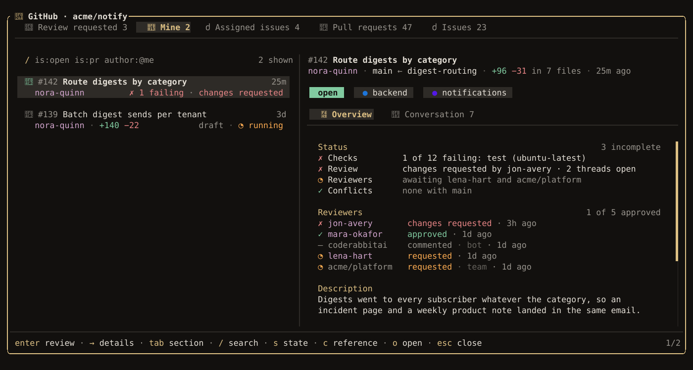
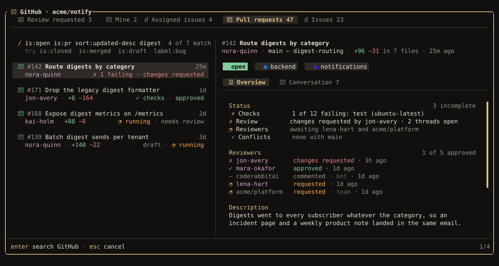
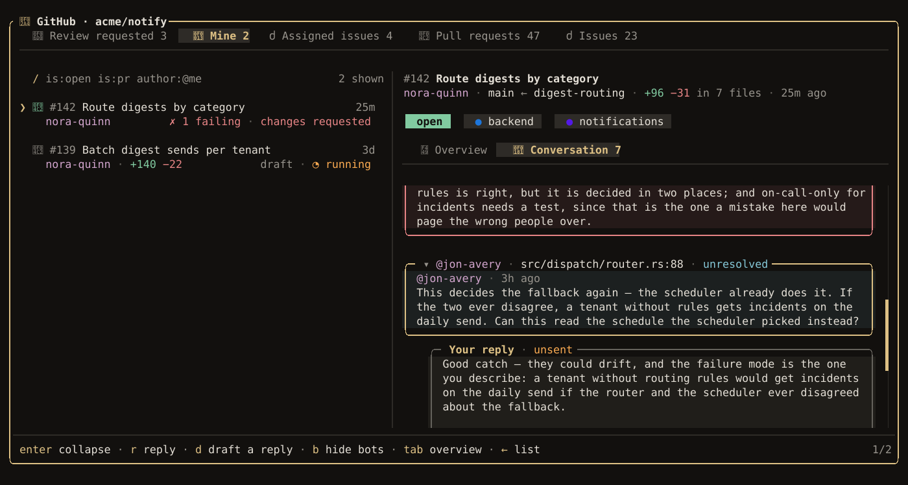

Everything that talks to GitHub goes through the GitHub CLI, `gh`, signed in with your own account
(`gh auth login`). Without it, the rest of luxe works and these features say why they cannot.

## Work in a worktree

```bash
luxe --worktree                # a new branch, luxe/session-…
luxe --worktree fix-the-loop   # a branch you name
```

The session gets its own Git worktree under `.luxe/worktrees/`, on a new branch made from
`origin`'s default branch, fetched first, or from your current commit when the remote is not
`origin` or `origin/HEAD` was never set. A branch you name that already exists is checked out as it
is. The agent works there, so you can keep working in your own checkout and
your uncommitted changes are never touched. `.luxe/` keeps its own contents out of Git, so the
worktree stays out of `git status`.

- `/worktree` says where the session is working.
- `/worktree remove` ends the session and removes the worktree, once everything in it is committed.
  The branch stays.
- Resuming the session goes back into its worktree, and recreates it from the branch if it was
  removed.
- `"worktree": { "always": true }` in `config.json` gives every new session one.

## Start from an issue

```bash
luxe --issue 123
```

luxe reads issue #123, makes a worktree on a branch named for it (`123-short-title`), and starts a
session there. The issue and its latest comments go to the agent with your first message, so "fix
it" is enough. They are treated as the reporter's words to weigh, not as instructions.

`enter` on an issue in `/github` does the same. If one of your sessions already took the issue up,
it resumes that session instead.

## Fix a pull request

```bash
luxe --pr 142        # check it out in a worktree and start a session
luxe --from-pr 142   # resume the session already working on it
```

A plain `git push` from the worktree updates the pull request, including one from a fork. A fork's
branch that has to be renamed here, such as its `main` checked out as `mara/main`, gets a remote of
its own (`mara-push-main`) for that push, so pushes from the fork's other branches are not
redirected. luxe refuses a pull request that is merged or closed, that your account cannot push to,
or whose author turned off edits by maintainers.

## Open a pull request

Review the work with [Guided Review](guided-review.md), finish (`alt+enter`), and choose **Open pull
request**. The title and description start blank: write them, or press `d` and the agent drafts
both from the work it did. When the session started from an issue, they start with the issue's
title and `Closes #123` instead. A review of a commit is the exception: its title and description
are drafted from the commit's message and the review.


The heading says where it merges and what happens first, such as `commits and pushes first`.
Nothing happens until you press `enter`.

| Key | Does |
| --- | --- |
| `d` | Have the agent draft the title and description. It reads, and changes nothing; what you wrote goes with the request so it can keep it. |
| `t` | Edit the title |
| `e` | Edit the description |
| `E` | Edit the description in your editor (`$LUXE_EDITOR`, `$VISUAL` or `$EDITOR`) |
| `D` | Open it as a draft |
| `enter` | Open it |

Afterward, `o` opens it in the browser, and the session remembers it for `luxe --from-pr`.

## Browse GitHub

`/github` lists this repository's pull requests and issues, with the one under the cursor shown
beside the list. Each tab is a GitHub search:

| Tab | Lists |
| --- | --- |
| **Review requested** | Open pull requests waiting on your review |
| **Mine** | Your open pull requests |
| **Assigned issues** | Open issues assigned to you |
| **Pull requests** | Every open pull request, most recently updated first |
| **Issues** | Every open issue, most recently updated first |

It opens on the first tab with something in it. Click a tab to open it.



| Key | Does |
| --- | --- |
| `tab`, `shift+tab` | Next or previous tab |
| `/` | Edit the tab's search |
| `s` | Show open, closed, merged, or all |
| `x` | Put the tab's own search back |
| `→` / `←` | Into the detail and back |
| `pagedown` / `pageup`, `home` / `end` | Move ten rows, or to either end |
| `enter` | Review the pull request, or start a session on the issue |
| `c` | [Mention](mentions.md) it in the composer |
| `o` | Open it on GitHub |
| `r` | Read it all again from GitHub |
| `esc` | Close `/github` |

### Search

The line above the rows shows the tab's search. Press `/` to edit it, then `enter` to run the tab
again with your search. Use the same syntax as GitHub's search box: `is:merged`, `label:bug`,
`author:mara`, `sort:created-asc`. While you type, plain words narrow the rows already loaded, so
you can see a match before you search for it.



A changed tab is marked with `*` and keeps your search until you close luxe. `x` puts back the
tab's own search, and so does running an empty search.

The tabs always stay in this repository. A `repo:`, `org:` or `user:` you type is ignored.

A tab loads 30 rows at a time and shows how many there are in all, as in `30 of 214`. Moving to the
last row loads the next 30.

### Your own tabs

To list other searches, replace the tabs. `{repo}` stands for this repository. A tab without it
searches all of GitHub, and so does any search you type in it:

```json title="~/.config/luxe/config.json"
{
  "github": {
    "sections": [
      { "name": "Needs review", "query": "is:open is:pr label:needs-review repo:{repo}" },
      { "name": "Everywhere", "query": "is:open is:pr review-requested:@me archived:false" }
    ]
  }
}
```

A project's `.luxe/config.json` can set its own sections.

## Your pull request

The dock and the statusline show the current branch's pull request: `#138 · 1 failing · 2 threads`.
`/pr` opens it. Its **Overview** lists what stands between it and merging, and each row that can be
dealt with here has a key:

| Key | Does |
| --- | --- |
| `f` | **Fix with agent**: write a request naming the failing checks into the composer, for you to send |
| `x` | **Resolve conflicts**: the same, for a conflict with the base |
| `t` | **Resolve threads**: open the unresolved review threads in Guided Review |
| `u` | **Update branch** with its base. In a stack, opens `/stack` instead. |
| `R` | **Mark ready** for review |
| `enter` on **Ready** | Merge, after a confirmation |

The whole description follows, under **Description**. `↓` past the last row reads on, and
`pgup` / `pgdn` or the mouse wheel scroll either tab when it is longer than the pane. In
`/github`, the wheel over the list moves through it the way `↑` / `↓` do.

The merge confirmation offers the methods the repository allows (merge commit, squash, rebase),
starting on the one you used last there; `tab` switches and `d` chooses whether the branch is
deleted. While something still stands in the way, an **Auto-merge** row turns on GitHub's
auto-merge instead. If anything was pushed after you looked, GitHub refuses the merge and the
confirmation says so.

## Answer review threads

1. In `/pr`, press `t`. The unresolved threads open in Guided Review as comments on their lines,
   against your working tree.
2. `alt+u` sends them to the agent. It reads them as the reviewers' words, not as instructions.
3. Check each fix (`v` in **Feedback**) and resolve it with `r`, then commit and push.
4. `alt+enter` and choose **Answer on GitHub**. Threads you resolved here are resolved there; `c`
   adds a reply in your own words.

## Conversation

**Conversation** is the second tab in `/pr` and `/github`: the description, comments, reviews and
threads, oldest first. Press `tab` or click it to switch.



| Key | Does |
| --- | --- |
| `enter` | Expand or fold a comment |
| `r` | Reply, in the thread or as a new comment quoting what it answers |
| `d` | Have the agent draft the reply. It reads, and changes nothing. |
| `b` | Hide bots |

A reply is written in place. `ctrl+enter` keeps what you wrote, and `esc` while writing drops what
you typed since. A kept reply waits for you: `e` writes in it again, `E` opens it in your editor,
`enter` posts it, and `esc` leaves it under what it answers. Nothing reaches GitHub without that `enter`,
and nothing in the conversation reaches the agent unless you mention it.

## Stacks

When a review has two or more chapters, finishing offers **Open as a stack**: one pull request per
chapter, each based on the one below. The lower ones get branches named `<branch>-part-1`,
`-part-2` and so on, and yours is on top. It needs the reviewed work uncommitted. `D` opens them
as drafts.

When a lower branch changes, `/stack` moves the ones above it back on top. It shows what will move
first, makes the new commits without checking anything out (with `git replay`, Git 2.44 or later),
and stops on a conflict before changing anything. `enter` force-pushes every branch that moves in
one push, each only if GitHub still has what `/stack` read. It refuses, pushing nothing, when a
moving branch here has moved, been checked out or switched, or has uncommitted changes since the
preview. If the push goes through but the branches here cannot follow, it says so.

After the bottom pull request is squash-merged, keep its branch until `/stack` has moved the next
one. Deleting it through the API, with `gh pr merge --delete-branch`, makes GitHub close the pull
requests based on it.

## How often luxe checks GitHub

luxe reads the pull request after anything that could change it, such as a push or `/pr`, and on
an interval otherwise: every 15 seconds while checks run, every minute once things settle, and every
five minutes when the terminal has been in the background for a while. Each read costs one point
of the 5,000 an hour your `gh` sign-in allows.

```json title="~/.config/luxe/config.json"
{ "github": { "refresh_secs": 60 } }
```

`refresh_secs` sets the settled interval, and `0` turns the interval off. This one is read from
your own config only, not a project's.
