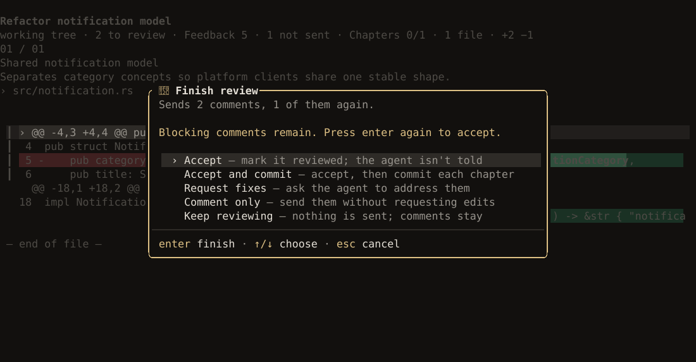
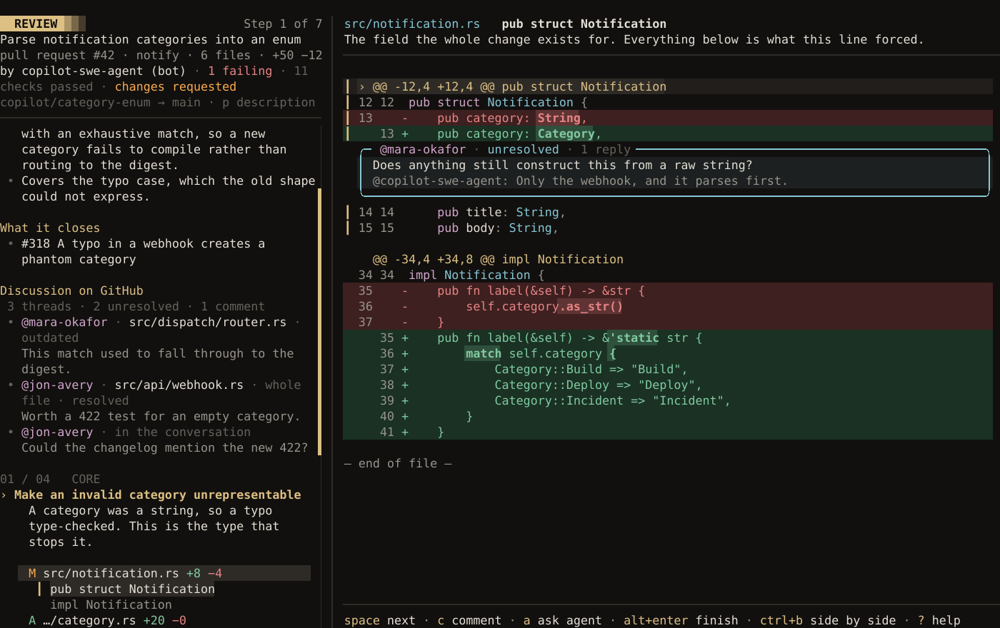

Guided Review reads a change back to you in the order it makes sense, split into chapters. Each
chapter says what changed, why, and how it was checked, beside the code. Comments you leave go to
the agent as work to do.


## Open a review

Press `ctrl+g`, or run `/diff`. luxe writes the guide first; when `review ready` shows above the
composer, press `ctrl+g` again to open it. Asked for while a turn is running, the review waits for
the turn to end. A review you already have opens at once, and one you had open when luxe stopped
comes back with your comments.

| Review | Command |
| --- | --- |
| Uncommitted changes | `/diff` |
| What the last turn changed | `/diff turn` |
| Everything since a branch or commit | `/diff base main` |
| One commit | `/diff commit 4c1e2a0` |
| A pull request | `/diff pr 142`, `/diff pr #142`, or its address |

Inside a review, `s` changes what it covers: uncommitted changes, the last turn, a base or a commit.
A pull request takes `/diff pr`. If the agent committed its work, so nothing is uncommitted,
`ctrl+g` and `/diff` review the last turn instead. luxe remembers what you have already reviewed in
each project, so the next review leads with what is new since then.

## Read it

The guide on the left opens with why the change exists and what it does, then a block per chapter
with its files. The right pane shows the hunk you are on, with the guide's sentence about it. Drag
the line between them to give the guide more or less room; double-click it to go back.

A cursor marks the line you are on with a `›` and a lighter band, and a comment or a question goes
on that line. The arrows move it down the screen, and the diff scrolls when it reaches an
edge. Click a line to put it there. The wheel scrolls the code, and the cursor stays on its row.

| To | Key |
| --- | --- |
| Next step. Past the last one, finish. | `space` or `n` |
| Previous step | `shift+n` |
| Next or previous chapter | `]` / `[` |
| Next or previous file | `ctrl+↓` / `ctrl+↑` |
| Move the cursor | `↑` / `↓`, `pageup` / `pagedown`, or half a page with `ctrl+d` / `ctrl+u` |
| Hide the guide, or the hunk's sentence | `g` / `z` |
| Side by side, or one column | `ctrl+b` |
| Wrap long lines | `w` |
| Search | `/` |
| Every key in the review | `?` |
| Back to the conversation | `esc`. The review stays pinned until you return. |

### What needs you

A review lists the hunks that need your attention and accounts for the rest. A hunk covered by a
test that passed says so on its own header and stays in the diff. Lockfiles, generated files,
moves and formatting-only changes fold away, each run of them in a file into one row; `f` opens
them all.

Two things are flagged and stay on the list, whatever else passed. Each flagged file says so on
its row and in the walkthrough, and the guide gives the total for any kind with more than two:

- A line that looks like a credential (`sk-…`, `ghp_…`, `AKIA…`, a `password = "…"`)
- A file the agent edited without reading first

If a test fixture needs a value that looks like a credential, mark that line with
`// luxe:allow-secret`, `gitleaks:allow`, `pragma: allowlist secret` or `nosec`.

To leave project bookkeeping out of every review:

```json title=".luxe/config.json"
{ "review": { "exclude": ["PROGRESS.md", "docs/design/**"] } }
```

The patterns take `*`, `**`, `?` and a trailing `/`, and a project's list replaces your own.
Excluded files are counted in the guide. luxe's own `.luxe/` is never reviewed.

A review leaves out a file it cannot hold, so the rest is still reviewable: in the last turn, any
file over 1 MiB, unreadable, or not a regular file; in uncommitted changes or a base, a new file
that is not ignored and is over 1 MiB or not a regular file. The top of the guide names each one,
so a review that shows less than the change never passes for all of it.

## Comment and ask

| Key | Does |
| --- | --- |
| `c` | **Comment** on the line under the cursor. It waits for you to send it: to the agent, or to GitHub with your review of a pull request. |
| `a` | **Ask the agent** about the line. It answers right away and changes nothing. |
| `alt+c` | **Feedback**: every comment, with the one under the cursor in full |
| `alt+u` | **Send** your new comments and replies to the agent, from a preview where `space` leaves one out |

In **Feedback**, `enter` goes to a comment, `c` replies, `e` edits, `x` deletes one not yet sent,
`r` resolves or reopens it, `d` shows its details, `v` shows what changed at its line, and `alt+u`
sends to the agent, as it does anywhere in the review. On someone else's pull request the hint says
`alt+enter` instead, since those comments go to GitHub. On an answered question, `c` turns it into
a comment, so the question, the answer and your direction reach the agent together.

Comments work like GitHub review threads: open until you resolve them. A row only adds a word for
**not sent** (GitHub's pending) or **outdated** (the line it was on has changed since). The comment
shown in full says where it stands in a sentence. A comment goes to the agent once; a reply sends
it again.

In the diff, `e`, `x` and `r` act on the comment under the cursor's line, and that comment's card
opens to show the agent's whole answer and its keys. Right-click a line for the same actions, or to
comment or ask about it.

You can keep commenting while the agent works on what you sent. When the agent's fix is in, the
review says `The fix is in · ctrl+r refresh`. `ctrl+r`, or `/diff refresh`, reads the code again
so you can verify it, at any time.

The agent ends a fix by reporting on each comment: fixed, not fixed, or needs clarification, with a
note. The note shows on the comment's thread, and the comment stays open until you resolve it,
since a claim is not proof: `v` shows what changed at its line. If the agent leaves its report out, luxe asks for it once. A comment
the agent still says nothing about reads `no word from the agent`, with the reason in Feedback,
and stays where you left it.

## Finish

`alt+enter` finishes the review:



| Choice | Does |
| --- | --- |
| **Accept** | Mark it reviewed. The agent is not told. |
| **Accept and commit** | Accept, then commit each chapter as its own commit, with the chapter's explanation as the message. Never pushes. |
| **Request fixes** | Send your comments for the agent to address |
| **Comment only** | Send your comments without asking for edits |
| **Keep reviewing** | Close this and carry on. Nothing is sent. |
| **Open pull request** | Commit, push and open a pull request drafted from the review. Offered when the branch has none. See [Git and GitHub](github.md#open-a-pull-request). |
| **Open as a stack** | One pull request per chapter. Offered with two chapters or more. |
| **Answer on GitHub** | On your own pull request: reply to and resolve the threads you fixed |

**Accept and commit** shows the commits first; `s` there makes them one. A review of a base or a
commit can only be committed that way. It refuses if files are already staged or the code changed
after the review was captured.

## Review a pull request

`/diff pr 142` reads a pull request into the same review: a teammate's, a bot's, or one another
agent opened. It needs the GitHub CLI, `gh`, signed in.



- It is pinned to the commit GitHub reported and compared from where it branched, as GitHub's
  **Files changed** does. Nothing in your checkout moves.
- The head says who opened it and where it stands: `by dependabot (bot) · 1 failing · changes requested`.
  Under that are its branches and `p description`, which reads the author's description over the
  review.
- Review threads appear under the lines they are about. Anything without a line is under
  **Discussion on GitHub**.
- `a` asks the agent about a line, at the pull request's commit.
- `ctrl+r` reads it again after a new push.

### Post your review

`alt+enter` on a pull request shows exactly what will be posted before anything is:

| Key | Does |
| --- | --- |
| `tab` / `shift+tab` | Choose **Comment**, **Approve** or **Request changes** |
| `c` | Write the summary. **Request changes** needs one. |
| `d` | Have the agent draft the summary from this review |
| `e` | Edit the summary |
| `enter` | Post it |

Line comments are listed under their files with the diff they sit on, the way GitHub shows them.
Questions you asked the agent stay in luxe and are never posted. GitHub doesn't let a pull
request's author approve it or request changes, so on your own pull request luxe offers only
**Comment**.

A drafted summary opens in the preview for you to read and edit. Anything the agent says beside it,
such as a part of the change it did not read, appears under it as a note. Once the review is
posted, the guide's foot says **Posted to GitHub** with the verdict, and `o` opens it.

### Fix it yourself

To change someone else's pull request rather than comment on it, press `alt+u`. luxe asks GitHub
whether you can push to it, then checks it out in a worktree of its own and starts a session there,
with your comments as the agent's first task. A plain `git push` then updates the pull request.
