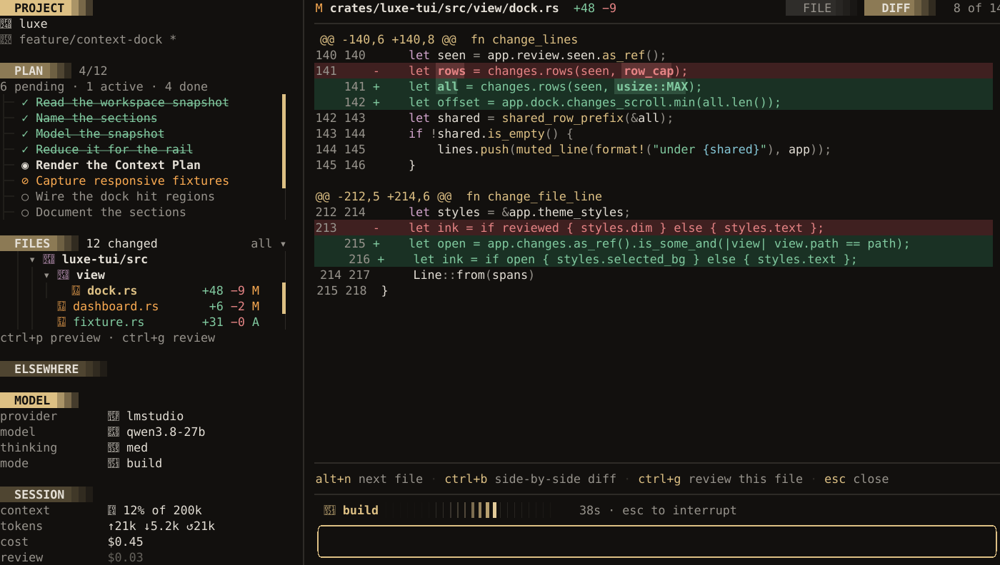
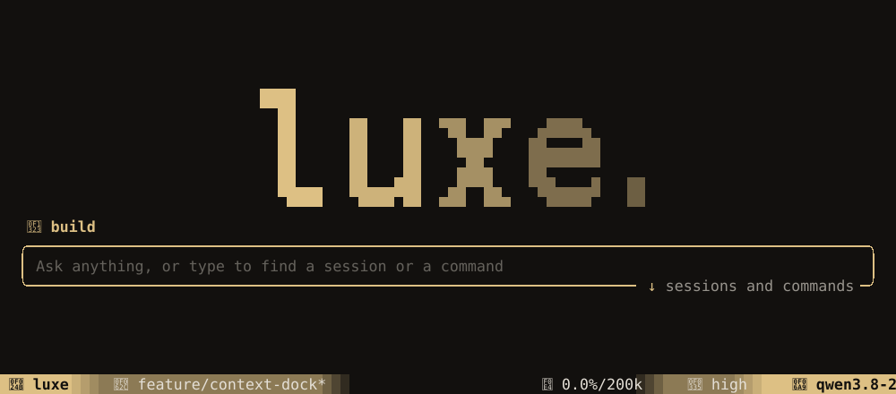

This page names the keys for each part of the screen. All of them, and how to rebind them, are in
[Commands and keys](commands.md); `/help` lists the ones for the screen you are on, and the
**Command Palette** (`ctrl+k`) finds any command by name. Which editor and file manager open is in
[Environment variables](environment.md#integrations).

## The start screen

luxe opens on a prompt. Type and press `enter` to ask in a new session, or choose a row from the
list under it with `↑`/`↓` and `enter`.

| Row | Opens |
| --- | --- |
| **Set up a provider** | Configuration. Leads the list, and takes `enter` on an empty prompt, until a provider is set up. |
| **Resume** | Your last session, named with its title and how long ago. Once a provider is set up, `enter` alone opens it. |
| **New session** | A fresh conversation |
| **Sessions…** | Every session in this project, searchable. `/sessions` opens it too, here or in a session. |
| **Review changes** | A [Guided Review](guided-review.md) of your uncommitted changes, when there are any |
| **Configuration** | Providers, credentials, [settings](configuration.md#settings) and config files, once a provider is set up |
| **Quit** | Leaves luxe. `ctrl+c` does too, here and in a session, even mid-turn, unless a prompt or menu is open, which it answers instead. |
| **RECENT** | Your other recent sessions |

Typing narrows the list. The first row becomes **Ask in a new session**, and under it come the
sessions whose titles match, the commands that do, and a search through every session's transcript.
A session you open this way keeps what you typed in its composer. Once a draft reads as a prompt
(more than five words or 48 characters, a second line, a pasted chip or a mention), the list folds
away and `enter` asks.

`/` and `@` open the same command and [mention](mentions.md) pickers a session has, under the
prompt. A command chosen there either opens over the start screen, as `/model` and `/theme` do, or
starts a new session to run in.


Every key is text here, so `esc` clears the prompt rather than quitting. `shift+tab`, or a click on
the prompt's title, switches between build and [plan mode](agent.md#plan-then-build) before you
start, and the session opens in the mode you chose. The statusline under it is the one the session
will have.

Nothing picks a model for you. Until you choose one, sending a message opens the model picker with
your message kept.

### Styles

```json title="~/.config/luxe/config.json"
{ "dashboard": { "style": "minimal" } }
```

`minimal` shows the prompt alone, and the list waits for `↓`. `"dashboard": false` skips the start
screen and opens a new session. **Start screen** in `/settings` sets the same key.



luxe works on the project it was started in. To switch projects, `cd` there and run `luxe`.

## The conversation

Each tool call the agent makes is a card, showing what it did and how long it took. `ctrl+o` shows
every card's full output, and clicking a card opens it.


A shell command card is titled by what the agent says the command is for, such as "Run the forms
tests", with the first line of the command under it and the rest a click away. A test run through
the shell that fails shows its counts and what failed, the same as the `test` tool's card.

Three or more lookups from one message (`read`, `grep`, `glob`, `ast_grep` and the code intelligence
tools) fold into one card that lists what they looked at: the first five by name, or four and a
count of the rest. So do three or more calls in a row to one MCP server, with nothing shown between
them. Click a folded card to open it into one card per call, and click again to fold it. Edits,
commands, `git`, the todo list and anything that failed always keep their own card. `"conversation":
{ "tool_runs": "cards" }` turns folding off.

Tables in a reply fit the width they are drawn at. Narrower than the table, cells wrap inside their
columns; too narrow for that, each row is listed as `Header: value` lines.

Code blocks in a reply are highlighted for their language. Click the rule above a block to copy it.

| To | Key |
| --- | --- |
| Scroll | wheel, `ctrl+↑` / `ctrl+↓`, `pageup` / `pagedown` |
| Jump to the newest output | `ctrl+end` |
| Search the conversation | `ctrl+f` |
| Select the previous or next message | `alt+k` / `alt+j` |
| Copy the selected message | `alt+y` |
| Edit your last message and send it again | `alt+e` |
| Ask again, after the last answer | `alt+t` |
| Replace the last answer | `alt+g` |
| View the newest image full-window | `alt+i` |

## The composer

`enter` sends. `shift+enter` adds a line. Type `/` for [commands](commands.md) and `@` to
[mention](mentions.md) a file, skill, issue or other context.

The composer's title names the session's mode, **build** or **plan**. `shift+tab` or a click on the
title switches it; see [Plan, then build](agent.md#plan-then-build).

While the agent works, you can keep typing:

| Key | Does |
| --- | --- |
| `enter` | **Steer**: the message reaches the running turn between steps, without stopping it |
| `alt+enter` or `alt+q` | **Queue**: the message becomes the next turn, after this one ends |
| `alt+↑` | Bring waiting messages back into the composer to edit |
| `esc` | Stop the turn, once nothing else open claims it and the composer is empty. `ctrl+esc` works too where the terminal sends it. Waiting messages come back into the composer. |

A waiting message sits above the composer, marked `steering` or `queued`, until it is delivered. A
message with an image is always queued, because steering carries text only.

`ctrl+v` or `shift+insert` pastes. Pasted text of three lines or more, or over 150 bytes, becomes a
`[Pasted 40 lines]` chip, and a pasted image becomes `[Pasted Image]`. Both are sent in full. A chip, like a mention, is deleted with one `backspace`.

The composer and every other text field take the usual line-editing keys:

| To | Key |
| --- | --- |
| Move by word | `ctrl+←` / `ctrl+→`, or `alt+←` / `alt+→` |
| Start or end of line | `home` / `end`, or `ctrl+a` / `ctrl+e` |
| Delete the word before or after | `alt+backspace` / `alt+delete` |
| Delete to the start of the line | `ctrl+u` |
| Select | `shift` with any move, or `alt+a` for everything |

On macOS, Option and Cmd with the arrows and `backspace` do the same in Ghostty, and in other
terminals with their natural text editing preset.

## The dock

The Context Dock is the column beside the conversation. It sits beside it on terminals 136 columns
or wider. On narrower ones it is hidden until you press `alt+d`, and then opens over the
conversation, or in its place below 80 columns.

| Section | Shows |
| --- | --- |
| **PROJECT** | The project, its branch, and the branch's pull request: `#138 · 1 failing · 2 threads` |
| **PLAN** | The agent's todo list, scrolled to what it is working on |
| **FILES** | The project as a tree, with what changed marked in it. Click a file to [preview](#preview) it and move the keyboard into it. |
| **ELSEWHERE** | Files the session changed outside the project, when there are any |
| **MODEL** | The provider, model, thinking level and [mode](agent.md#plan-then-build). Click the provider or the model to change it, or the mode to switch it. |
| **USAGE** | On a subscription such as ChatGPT or GitHub Copilot, how much of each of the plan's windows you've used and when it resets: `weekly 30% · resets 3d 4h`. It turns yellow at 75% and red at 90%, and shows up once the provider reports it. |
| **SESSION** | Context used, tokens and cost, with what a review and compaction cost on rows of their own. A review's row shows its full cost once its guide or drafted summary is done. While a phone or another client has [joined](remote.md), a **joined** row names it. |

`alt+d` shows or hides the dock, and `/dock left` or `/dock right` moves it. To set it for good:

```json title="~/.config/luxe/config.json"
{
  "dock": { "mode": "auto", "position": "left" }
}
```

`mode` is `auto` (beside the conversation when there is room), `shown` or `hidden`.

Drag the line between the dock and the conversation to make the dock wider or narrower. It stays
that width the next time luxe starts; double-click the line to put it back.

### Choose the sections

`dock.sections` lists the sections to show. Leave one out to hide it:

```json title="~/.config/luxe/config.json"
{
  "dock": { "sections": ["project", "plan", "files", "model", "session"] }
}
```

That hides **ELSEWHERE** and **USAGE**. Without the key, every section shows. PROJECT stays at the
top and MODEL, USAGE and SESSION at the bottom, so the order you give them applies within those
groups: `["session", "model"]` puts SESSION above MODEL. luxe skips a name it doesn't know.

Hiding **MODEL** still shows its **approvals** row while auto-approve is on, so you can't lose
sight of it. With **FILES** hidden, `ctrl+t` says so instead of moving into a tree you can't see.

### Your own sections

A section can show what a program of yours prints: your quota as bars, CI status, anything that
fits in a few rows. Define it under `dock.custom` and add its name to `dock.sections`:

```json title="~/.config/luxe/config.json"
{
  "dock": {
    "sections": ["project", "plan", "files", "model", "quota", "session"],
    "custom": {
      "quota": { "command": ["~/bin/luxe-quota"], "title": "QUOTA" }
    }
  }
}
```

Without `sections`, your sections show after the built-in ones. One with the name of a built-in
section takes its place, so `"session"` draws your own SESSION.

| Key | Default | Meaning |
| --- | --- | --- |
| `command` | required | The program and its arguments. It runs directly, not through a shell, in the project folder. A leading `~/` is your home folder. |
| `title` | the name, in capitals | The heading |
| `place` | `bottom` | `bottom`, beside MODEL and SESSION, or `middle`, with PLAN and FILES |
| `timeout_ms` | `2000` | How long a run may take, up to 10 seconds |

luxe runs the program when a session starts or resumes, after each turn, and when the provider
reports plan usage. There's no timer, and the conversation never waits for it. The program gets
the session's state as JSON on stdin:

```json
{
  "version": 1,
  "section": "quota",
  "place": "dock",
  "session_id": "1bdcd3fd-419f-4102-af4e-0adc5aba74d9",
  "cwd": "/home/you/project",
  "provider": "chatgpt",
  "model": "gpt-5.5",
  "context": { "used_tokens": 50000, "window": 200000, "used_percent": 25.0 },
  "plan_usage": {
    "plan": "plus",
    "primary": { "used_percent": 30.0, "window_minutes": 10080, "resets_in_secs": 270000 }
  },
  "session_usage": null
}
```

`place` is `dock` here, or `statusline` when the program feeds a
[statusline module](appearance.md#your-own-modules), so one program can serve both and answer
shorter for the bar. A field luxe has no value for yet is `null`. `plan_usage` and `session_usage`
have the shape of the [events](rpc.md#events) of the same names: `session_usage` is the session's
tokens and cost so far, and `plan_usage` leaves out a window the plan doesn't have. New fields may
be added, and none are removed.

The program can size itself to the row, the way a program sizes itself to a terminal. `COLUMNS`
is how many cells a row has, label included, and `LUXE_LABEL_COLUMNS` is how many of those the
label column takes, so a labeled row has the difference for its text. Both follow the dock as you
drag it wider or narrower, and a new width runs the program again (during a turn, once it ends).
Until the interface has drawn the dock, neither is set.

The program answers on stdout, one row per line:

```text
weekly ▰▰▰▱▱▱▱▱ 30%
5h     ▰▱▱▱▱▱▱▱ 12%
```

Or in JSON, for labels and color:

```json
{"rows": [{"label": "weekly", "spans": [{"text": "▰▰▰▱▱▱▱▱", "ink": "accent"}, {"text": " 30%"}]}]}
```

A `label` lines up with the labels in MODEL and SESSION. `ink` is a color from your theme: `text`
(the default), `muted`, `dim`, `accent`, `success`, `warning` or `error`. luxe draws up to 8 rows,
cuts each one to fit the dock, and removes escape sequences and control characters.

A section shows up once its program first answers, and printing nothing (or `{"rows": []}`) hides
it until a run prints something. When a run fails (it exits with an error, takes too long, prints
more than 16 KB, or prints JSON luxe can't read), the section keeps its last rows and adds one
saying why, such as `last run: exited 1`. The log has more. A change to `dock.custom` takes effect
in the next session. [Recipes](recipes.md#plan-usage-as-bars) has a complete one.

A run is over when the program exits. A timeout ends it along with everything it started. A
background job it leaves behind keeps running if its output goes elsewhere
(`fetch-quota > ~/.cache/quota.json 2>/dev/null &`), and is ended if it still holds the
program's output a moment after the program exits. So for something slow, start it in the
background that way and print what the last run saved.

A project's `dock.custom` runs programs, so luxe ignores it without `--trust-project`, as it does
the project's [hooks](hooks.md).

### Files

**FILES** is the project's tree. Dotfiles such as `.github` are in it; what `.gitignore` ignores is
not, until you ask for it. Folders on the way to a changed file open on their own, so the change is
in view; a changed file shows its letter (`M`, `A`, `D`, `?`) and its line counts, and a closed
folder with a change inside shows a dot. A folder holding only one folder is drawn as one row,
`crates/luxe-core/src`. `all ▾` on the heading opens a menu: show only what changed, or show the
ignored files too, drawn faint.

Click a folder to open or close it, and a file to [preview](#preview) it; the file showing is drawn
in the accent color. Right-click either for everything you can do with it.

The tree only reads. To move, rename or delete files, ask the agent, which goes through your
permissions and shows up in the review, or press `O` to open the folder in your file manager. A
terminal one such as yazi takes the screen until you quit it, as your editor does; the tree reads
its folders again when you come back.

`ctrl+t` moves the keyboard into the tree, and pressed again, into the file showing beside it.
`tab` trades the keyboard between the two, and `esc` hands it back to the composer.

| In the tree | Key |
| --- | --- |
| Move | `j` / `k`, or the arrows |
| Find a file by typing part of its path | `/` |
| Open a folder, or show a file | `enter` |
| Open a folder, or show a file and move into it | `l` |
| Close a folder, or go to its parent | `h` |
| Open in your editor | `o` |
| Open its folder in a file manager | `O` |
| Mention it in the composer | `@` |
| Copy its path | `y` |
| Only what changed, or everything | `a` |
| Show the ignored files, or hide them | `i` |
| Read the folders again | `R` |
| Back to the composer | `esc` |

Any other key goes to the composer, so you can start typing without leaving the tree first.

`/` filters the tree as you type. It searches the whole project, not just the open folders, and
matches the letters in order anywhere in the path, so `tuiview` finds `crates/luxe-tui/src/view.rs`.
The tree shows the best matches under the folders that hold them, with the matched letters lit.
The arrows move through them, and `enter` shows one. `esc` clears the filter and leaves the
cursor on the file you found. Files `.gitignore` ignores are never matched, even while the tree is
showing them.

## The statusline

The statusline is the bar under the composer. It carries the same model, context and cost the
dock does, so by default it shows only when the dock is not beside the conversation. That makes
`alt+d` a swap on a wide terminal: hiding the dock brings the statusline back, and showing it puts
the statusline away. `alt+s` or `/statusline show`, `hide` or `auto` changes that, and
`"statusline": { "visibility": "shown" }` keeps it. [Statusline modules](appearance.md#statusline)
sets what it shows.

## Preview

The **preview** (`ctrl+p`) shows one file in place of the conversation, with the dock and the
composer where they were, so you can reply about what you see. A changed file opens on its diff, and
`alt+m`, or **FILE** in the header, shows it whole; **DIFF** goes back. Any other file opens whole.
Click another file under `FILES` to switch; click the open one, or press `esc`, to go back.
`/preview src/app.rs` opens a given file.

To ask about part of a file, drag across its lines (or click one) and choose **ask about lines**
under them, or press `alt+l`. The composer gets `@[file:src/app.rs:40-52]`: the agent receives the
path and the lines, and reads them itself. Right-click the lines to copy them instead.

On a wide terminal the conversation stays beside the diff. The diff takes the width code needs,
about 134 columns in one column or 218 side by side, and the conversation gets the rest.
Drag the line between them to change the split, and double-click it to go back.

The preview is not a review: looking at a file does not count it as reviewed.

| In the preview | Key |
| --- | --- |
| Next or previous changed file | `alt+n` / `alt+p` |
| The whole file, or its diff | `alt+m` |
| Ask about the lines you picked | `alt+l` |
| Side by side, or one column | `ctrl+b` |
| Wrap long lines, or not | `alt+w` |
| Open the file in your editor, at the top line shown | `alt+o` |
| Open a [Guided Review](guided-review.md) of your changes, at this file | `ctrl+g` |
| Back to the conversation | `esc` |

With the keyboard in the file, a cursor marks the line you are on with a `›` and a lighter band,
and the file scrolls to keep it in view. Clicking a file under `FILES` or a line in the file puts
the keyboard there, as do `ctrl+t` twice and `tab` from the tree. In a diff the cursor moves the
same way, row by row, and picks nothing.

| In the file | Key |
| --- | --- |
| Move the cursor | `j` / `k`, or the arrows; `space` / `pageup` a page, `ctrl+d` / `ctrl+u` half of one; `g` / `G` the ends |
| Select lines, like vim's visual-line mode: moves grow the pick, `o` moves its other end | `v` or `V` |
| Grow a pick by one line without the mode | `J` / `K`, or `shift` with the arrows |
| Ask about the pick, or the cursor's line | `enter` |
| Copy the pick, or the cursor's line | `y` |
| Open in your editor at the cursor | `o` |
| Back to the tree | `tab` or `h` |
| Drop the pick or leave visual mode, then back to the composer | `esc` |

## Mouse and clipboard

The wheel scrolls whatever is under the pointer, and a click acts on what you click. Drag any
scrollbar to scroll, or press anywhere on it to jump.

The lines between panes move: the dock's, the preview's, and the one beside a review's guide. A line
lights under the pointer; drag it to resize the pane beside it, or double-click it to put the pane
back to its own width. luxe remembers the widths for next time.

Drag across the conversation, the composer or the preview to select. Double-click takes a word and
triple-click a line. The selection stays highlighted until you copy it, so letting go never changes
your clipboard. The conversation scrolls to keep the end you are moving in view:

| Key | Does |
| --- | --- |
| `shift` + an arrow, `home` or `end` | Grow or shrink the selection |
| `ctrl+shift+c`, `ctrl+insert`, `super+c` | Copy it |
| `esc` | Drop it |

Right-click a selection for **Copy**, or the composer for **Paste**. Click a message to copy all of
it.

Your terminal's own copy key reaches luxe only if the terminal passes it through. Most terminals
keep `cmd+c` (and on Linux often `ctrl+shift+c`) for themselves, so let the key fall through when
the terminal has nothing selected, or hold `shift` (`option` on macOS) while dragging to make a
selection the terminal copies itself. In Ghostty:

```ini title="ghostty config"
keybind = performable:control+insert=copy_to_clipboard
keybind = performable:super+c=copy_to_clipboard
keybind = copy=copy_to_clipboard
```

The last line matters on Linux. Ghostty makes one of its copy keys a window shortcut that takes the
key even when `performable:` says to let it through. A plain binding on the dedicated Copy key gives
that job to a key you never press. On Omarchy, `super+c` reaches the terminal as `ctrl+insert`, so
without that line it never gets to luxe.

luxe copies to the desktop clipboard, and over SSH through the terminal (OSC 52). Inside tmux,
that needs `set -g set-clipboard on`.

`/mouse off` hands the mouse back to the terminal for the session, and `"mouse": false` in
`config.json` starts with it off. `"conversation": { "scroll_lines": 5 }` sets how far a wheel
notch scrolls, from 1 to 20 lines (3 by default).
