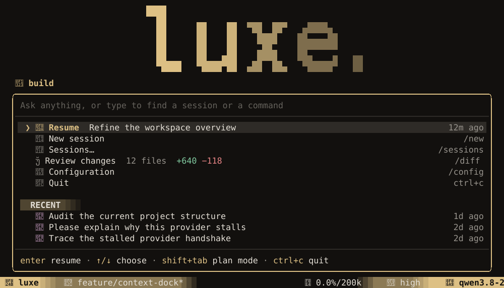
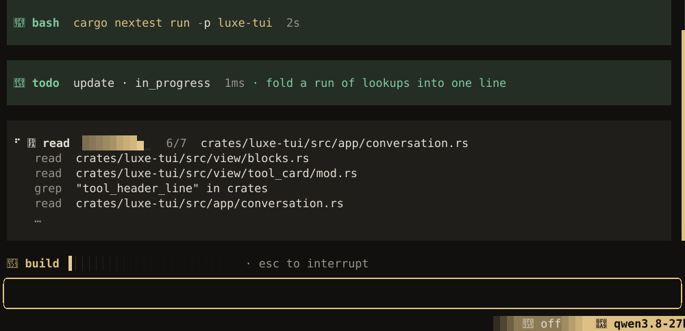
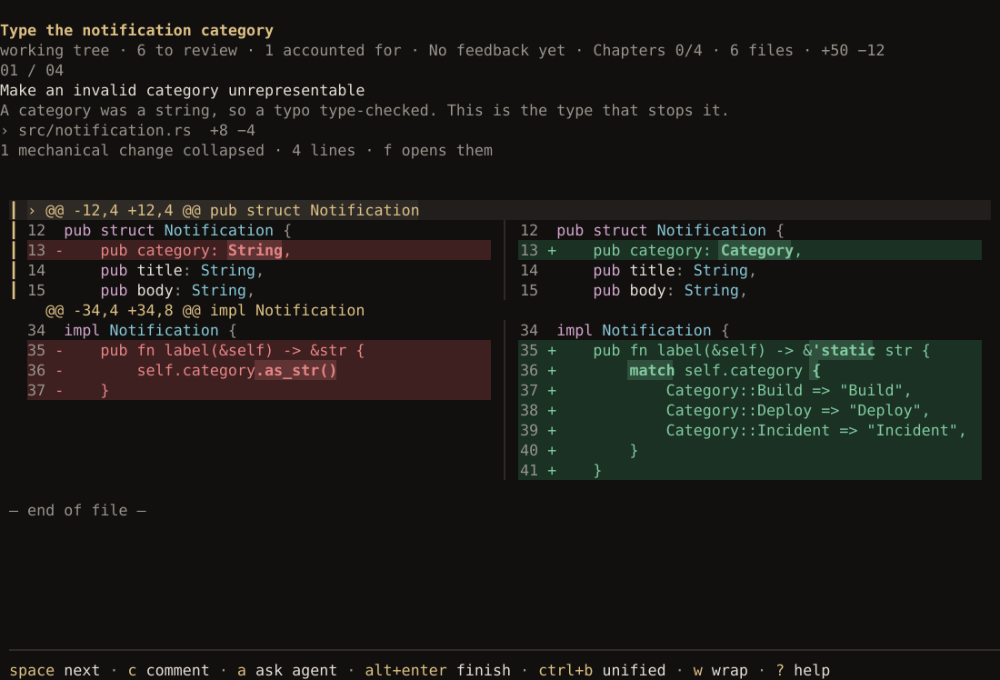
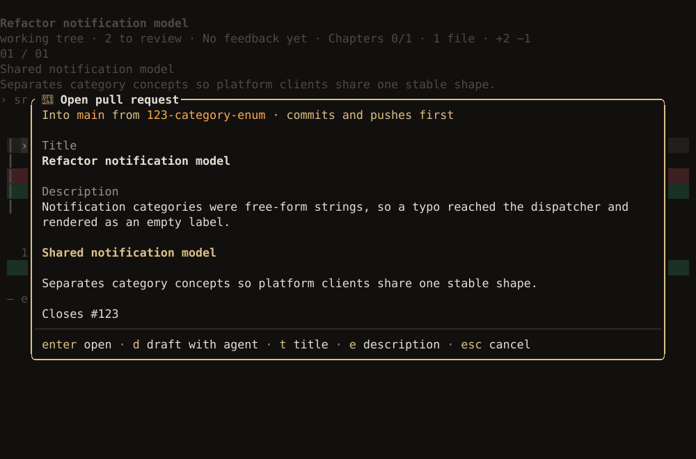

This walks through one change from start to finish: connect a model, ask for something, review
what the agent did, and open a pull request.

## 1. Start luxe in your project

```bash
cd your-project
git switch -c category-enum    # a branch for the work, so it can become a pull request
luxe
```

Reviewing changes and opening a pull request need a Git repository. A pull request also needs a
branch other than the one it merges into; `luxe --worktree` makes one for you, in a
[worktree](github.md#work-in-a-worktree) of its own.

The first time, luxe asks four questions: a theme, a provider, which tools the agent can use, and
what luxe opens on. Each one previews or explains itself, and `enter` moves on. `s` skips setup and
keeps none of the answers, though a provider you signed in to stays signed in. Your answers go to
`~/.config/luxe/config.json`, and `/settings` or `luxe init` changes them later.


After that, luxe opens on the start screen: a prompt, with your last session, your other sessions
and **Configuration** listed under it, or **Set up a provider** first if you have none yet. Type to ask something or to find a session or a command, or
use `↑`/`↓` and `enter` to open a row.



## 2. Connect a model

If you skipped the provider question, the start screen leads with **Set up a provider**. Open it
and pick one:

| Option | For |
| --- | --- |
| **Sign in to a subscription** | ChatGPT Plus or Pro, GitHub Copilot, OpenRouter |
| **Add an API key** | OpenAI, Anthropic, Google, Groq and others |
| **Connect a local or custom model** | LM Studio, Ollama, Azure, any OpenAI-compatible endpoint |


When it connects, the model picker opens. Choose a model, and change it any time with `/model`.

An API key in your environment works too. luxe finds `ANTHROPIC_API_KEY`, `OPENAI_API_KEY`,
`GEMINI_API_KEY` and the rest, and offers that provider's models. To sign in from a script or a
machine without the interface, use the CLI:

```bash
luxe auth login                       # choose a provider from a list
luxe auth login anthropic --stdin < key.txt
luxe auth list                        # every provider and how it is configured
```

Credentials are stored in `~/.config/luxe/auth.json`, readable only by you. See
[Providers](providers.md) for every option.

## 3. Ask for something

Type what you want on the start screen and press `enter`: it starts a new session and sends it.
`shift+enter` adds a line.

```
a notification's category is a free-form string, so a typo compiles; make it an enum
```

The agent reads, edits and runs commands, and each step appears as a card. Click a card to see its
full output, or press `ctrl+o` for every card's; `esc` stops the turn. You can keep typing while it works:
a message sent mid-turn reaches the agent between steps, without stopping it.



**Changes** (`ctrl+p`) shows the diff so far, beside the conversation on a wide terminal and in its
place on a narrow one.

## 4. Review the change

Press `ctrl+g` to start a **Guided Review**. luxe writes a guide to the change, split into
chapters, each with what changed, why, and how it was checked, next to the code. When
`review ready` shows above the prompt, press `ctrl+g` again to open it.



| Key | Does |
| --- | --- |
| `space` | Next |
| `c` | Comment on the line under the cursor |
| `a` | Ask the agent about it |
| `alt+enter` | Finish the review |
| `?` | Every key in the review |

Comments go to the agent as work to do when you finish with **Request fixes**.

## 5. Open a pull request

This needs the GitHub CLI, `gh`, signed in (`gh auth login`): **Open pull request** is offered once
`gh` says the branch has none. Finish the review (`alt+enter`) and choose it. The title and
description start blank, and `d` has the agent draft both. The heading says what happens before it
opens, such as "commits and pushes first". The pull request pictured came from a session that took
up an issue ([`luxe --issue 123`](github.md#start-from-an-issue)), so its branch is named for the
issue and its description closes it.



Press `t` or `e` to edit the title or description, `D` to open it as a draft, and `enter` to open
it.

## 6. Come back later

**Resume**, the first row on the start screen, picks up your last session. From the command line:

```bash
luxe -c                    # the most recent session in this project
luxe sessions list         # this project's sessions, newest first
luxe --resume <id>         # a specific one
```

## Next

- [The interface](interface.md): the dock, the statusline, the Command Palette and every command.
- [Guided Review](guided-review.md): reviewing someone else's pull request, and answering review
  threads on yours.
- [Configuration](configuration.md): themes, keys and the statusline.
- [Project context](project-context.md): give the agent your project's conventions in `AGENTS.md`.
