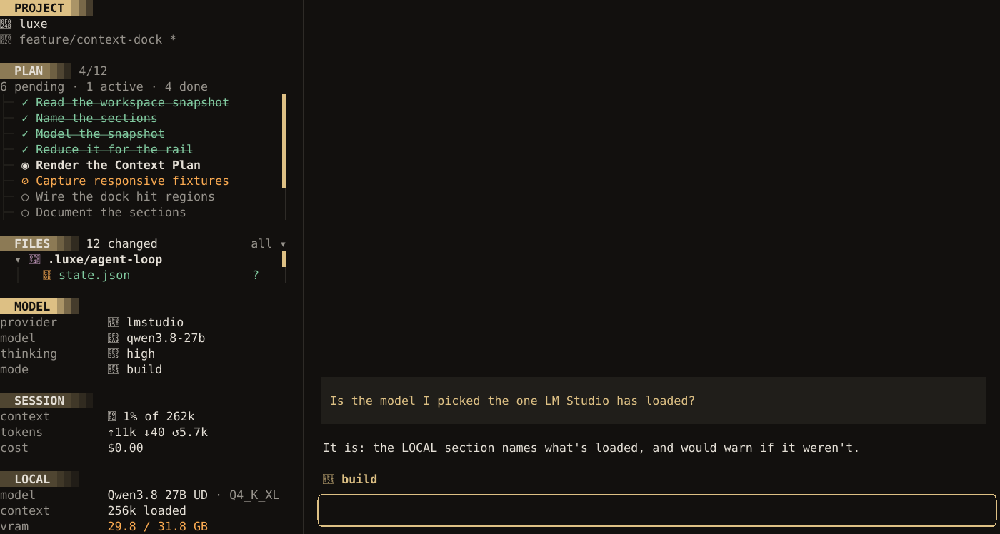
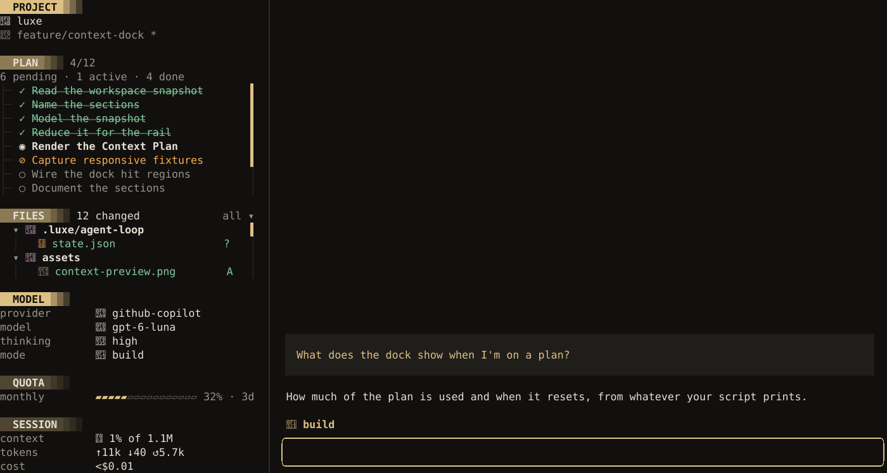
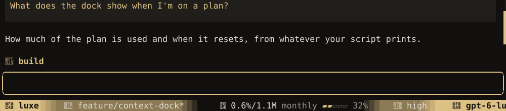

## Asana

Two ways to bring Asana in, and they work together: its MCP server, so the agent can read and update
tasks, and a mention source, so you can point at one task with `@`.

### The MCP server

Asana registers each app, so each person makes one of their own.

1. **Register an MCP app** in Asana's developer console (**My apps**). Set its redirect URL to
   `http://127.0.0.1:8765/callback`, and leave **This is a native or command-line app** unchecked.
   Share it with your workspace. Your organization may need an admin to approve it.
2. **Keep the secret in your environment.** In `~/.zshrc` or `~/.bashrc`, then open a new
   terminal:

   ```bash
   export ASANA_MCP_CLIENT_SECRET='…'
   ```

3. **Add the server**, with your app's client ID, and hide the tools Asana marks as internal:

   ```json title="~/.config/luxe/mcp.json"
   {
     "mcpServers": {
       "asana": {
         "url": "https://mcp.asana.com/v2/mcp",
         "auth": {
           "kind": "oauth",
           "client_id": "1209…",
           "client_secret": "${ASANA_MCP_CLIENT_SECRET}",
           "redirect_uri": "http://127.0.0.1:8765/callback"
         },
         "exclude_tools": [
           "get_project_internal", "search_objects_internal", "log_widget_event",
           "create_task_confirm", "save_task_changes_confirm", "create_project_confirm",
           "create_project_confirm_populate", "save_project_changes_confirm"
         ]
       }
     }
   }
   ```

4. **Sign in** and check what you can use:

   ```bash
   luxe mcp login --id asana
   luxe mcp tools
   ```

5. **Decide what the agent may do.** Task names and comments go to your model provider when a tool
   returns them. To let reads through and ask before anything changes:

   ```json title="~/.config/luxe/permissions.json"
   {
     "permission": {
       "mcp": {
         "asana/create_*": "ask",
         "asana/update_*": "ask",
         "asana/delete_*": "ask",
         "asana/add_*": "ask"
       }
     }
   }
   ```

   If Asana's data may only go to a provider your organization approves, use
   `"asana/*": "deny"` until you are on one. In a headless or loop run, make the writes `deny`:
   nobody is there to answer an `ask`.

6. **Use it:** *@[mcp:asana] what is due this week?*

### Your tasks in the `@` picker

This needs a personal access token (**My apps → Personal access tokens**), since the MCP sign-in's
token works only for the MCP server. Your workspace's ID is in
`https://app.asana.com/api/1.0/workspaces`, read with the same token.

```bash title="~/bin/asana-mentions"
#!/bin/sh
curl -sSf -H "Authorization: Bearer $ASANA_PAT" -G https://app.asana.com/api/1.0/tasks \
  --data-urlencode assignee=me --data-urlencode "workspace=$ASANA_WORKSPACE" \
  --data-urlencode completed_since=now --data-urlencode limit=100 \
  --data-urlencode opt_fields=name,due_on,permalink_url |
jq -c '.data[] | (if .due_on then "due \(.due_on)" else "no due date" end) as $due | {
  id: .gid,
  label: .name,
  detail: $due,
  text: "Asana task \"\(.name)\" (\($due)) \(.permalink_url)"
}'
```

```json title="~/.config/luxe/config.json"
{ "mentions": [{ "name": "Asana", "command": "asana-mentions" }] }
```

A task you pick goes in as `@[asana:1209…]` and reaches the agent as its name, due date and link,
and the agent can look it up through the MCP server. See [Mention sources](mention-sources.md).

## Subagents

A subagent is a separate context that does one job and returns a summary, which is what a headless
luxe run is:

```bash
luxe --headless --read-only --model openai/gpt-5.6 --format json \
  -p "review src/parser.rs for edge cases" |
  jq -rs 'map(select(.type == "message" and .text != "")) | last.text'
```

`--read-only` keeps the subagent from changing anything, and `--model` lets it be a different model
from the one doing the work. The `jq` filter keeps the last message with text in it, which is the
summary. For a review of your own uncommitted work, [`/review`](agent.md#a-second-opinion) does
this without the wrapper.

To let the agent start one itself, wrap that command in an MCP server with a
`delegate(task, model)` tool. Then:

- Rule it like any tool: `"mcp": { "delegate/*": "ask" }` in `permissions.json` puts each one in
  front of you.
- Give the server a `timeout_secs` longer than a review takes. A call gets 60 seconds by default,
  and one that runs out stops the subagent.
- Return the subagent's stderr when it fails, so the agent sees why.
- Give a subagent that writes its own worktree, with `git worktree add`, so it stays out of yours.

luxe refuses to nest more than two levels deep, since an agent that starts two subagents per turn
would multiply fast. `LUXE_MAX_DEPTH` raises the limit.

## A guard that asks a model

A `BeforeToolUse` [hook](hooks.md) can ask a small classifier model whether a command is
destructive, and ask you when it might be. This one calls a typed decision model running on your
own machine, and the request follows that model's API; any model that returns a probability works.

```bash title="~/.config/luxe/hooks/risk-gate.sh"
#!/usr/bin/env bash
set -euo pipefail
command=$(jq -r '.ToolUse.args.command')

risk=$(jq -n --arg c "$command" '{
    state: { command: $c },
    questions: { destructive: { type: "noul",
      instructions: "Would running this command cause irreversible data loss?" } }
  }' |
  curl -sS --max-time 2 "${DECISION_URL:-http://localhost:8000}/v1/systemone" \
    -H 'Content-Type: application/json' --data @- |
  jq -r '.answers.destructive.noul')

if awk "BEGIN{exit !($risk > 0.8)}"; then
  jq -n --arg r "scored $risk for irreversible data loss" '{decision:"ask", reason:$r}'
else
  echo '{"decision":"allow"}'
fi
```

```json title="~/.config/luxe/hooks.json"
{
  "BeforeToolUse": [
    {
      "matcher": "bash",
      "command": ["/home/you/.config/luxe/hooks/risk-gate.sh"],
      "timeout_ms": 2500,
      "on_timeout": "ask"
    }
  ]
}
```

- **It asks rather than blocks.** A hook can only make a call harder, so the worst a wrong answer
  costs is a prompt.
- **It adds to your rules, not replaces them.** Keep what must always hold in
  [`permissions.json`](security.md).
- **It runs before every matching call.** The `matcher` keeps it off `read` and `grep`; narrow it
  further, such as `{ "bash": "rm *" }`, to cost less.
- **`on_timeout: "ask"`** puts the question to you if the classifier is down.
- **Nobody answers in a headless run**, so its `ask` is allowed there. Use `--on-ask deny`, or
  `"hook_ask": "deny"` in `permissions.json`, to make it hold.

## Run luxe in Herdr

[Herdr](https://herdr.dev) keeps coding agents in panes and shows which ones are working, waiting
on you, or done. luxe reports its state to Herdr on its own when it runs in a Herdr pane:
**working** during a turn, **blocked** when it needs you, and **done** when the turn ends.

```bash
curl -fsSL https://herdr.dev/install.sh | sh
herdr
luxe        # in a pane
```

To let the agent drive Herdr, such as splitting panes or starting other agents, add Herdr's skill:

```bash
mkdir -p ~/.config/luxe/skills/herdr
curl -fsSL https://raw.githubusercontent.com/ogulcancelik/herdr/master/SKILL.md \
  -o ~/.config/luxe/skills/herdr/SKILL.md
```

`LUXE_HERDR=0` or `{ "herdr": false }` in luxe's config turns the reporting off.

### luxe colors in Herdr

Herdr has no theme files — it takes a built-in theme plus per-token overrides. This is luxe's
own palette in those tokens, so the pane and the multiplexer around it read as one program:

```toml title="~/.config/herdr/config.toml"
[theme]
name = "vesper"          # the closest built-in; every token below is overridden anyway

[theme.custom]
accent        = "#ddc084"  # champagne, the one color luxe leads with
text          = "#e4dfd6"
subtext0      = "#97938c"
overlay0      = "#4d4a45"
overlay1      = "#97938c"
sidebar_bg    = "#12100e"  # the base surface, same as luxe's background
panel_bg      = "#12100e"  # the tab bar sits on it too, so the chrome is one field
surface0      = "#201e1a"
surface1      = "#2e2b27"
surface_dim   = "#201e1a"
active_row_bg = "#201e1a"  # the current space, at rest
selection_bg  = "#2e2b27"  # the Navigate cursor, which should be the brighter of the two
mauve         = "#d2a5cd"  # branch names
yellow        = "#ddc084"  # working — an agent at work glows in the accent
green         = "#81caa0"  # idle / done
red           = "#e68485"  # blocked, needs you
peach         = "#faaa51"  # interrupted
blue          = "#85c7d7"  # luxe has one cool hue, so blue and teal share it
teal          = "#85c7d7"

[ui]
accent = "#ddc084"         # borders and navigation chrome, which read off their own key
```

Reload it in place with `prefix+shift+r`, or `herdr server reload-config`. For any of the other
[themes](appearance.md) luxe ships, the hexes are in its theme file and the token names above do
not change.

The one token worth a second thought is `panel_bg`: Herdr draws the active tab as `panel_bg` text
on an `accent` fill, so it has to stay dark enough to read there. Lifting it to `#201e1a` gives the
tab bar a surface of its own if you prefer the chrome delineated.

## luxe from your phone

Your sessions keep running on your computer, and your phone or tablet reaches them over
[Tailscale](https://tailscale.com), a private network between your own devices. Nothing is opened to
the internet. This is the terminal over SSH; [luxe on your phone](remote.md) is luxe's own way in.

1. Install Tailscale on the computer and on the phone, and sign in to the same account on both.
2. On the computer, turn on SSH. On Linux and macOS, Tailscale can do it for you:

   ```bash
   sudo tailscale up --ssh
   ```

   On Windows, turn on the OpenSSH Server in Settings, under Optional features.
3. Run luxe in [Herdr](#run-luxe-in-herdr), so your sessions outlive the terminal you started
   them in.
4. On the phone, connect with an SSH app such as Blink Shell or Termius, using the computer's
   Tailscale name, and run `herdr`. It attaches to the panes you left, with luxe where it was.

```bash
mosh you@desk -- herdr
```

[Mosh](https://mosh.org) keeps the connection through a locked screen or a switch from Wi-Fi to
cellular. It needs `mosh` installed on the computer too, which Linux and macOS have and Windows
does not; plain `ssh` works everywhere.

On an iPad with a keyboard, this is luxe as you know it. On a phone, luxe fits a narrow screen,
and Herdr marks which session is waiting on you.

### A notification when luxe needs you

[luxe on your phone](remote.md#notifications) has notifications built in. Without it, a
[hook](hooks.md) can post to [ntfy](https://ntfy.sh), whose app shows it on your phone:

```json title="~/.config/luxe/hooks.json"
{
  "PermissionRequested": [
    { "command": ["curl", "-s", "-d", "luxe is waiting for an approval", "https://ntfy.sh/your-topic"] }
  ],
  "BeforeToolUse": [
    { "matcher": "question", "command": ["curl", "-s", "-d", "luxe has a question", "https://ntfy.sh/your-topic"] }
  ],
  "AgentEnd": [
    { "command": ["curl", "-s", "-d", "luxe finished", "https://ntfy.sh/your-topic"] }
  ]
}
```

- **Anyone who knows an ntfy.sh topic can read it**, so pick a long random name, or run ntfy
  yourself on your Tailscale network. The messages above say only that something is waiting, never
  the command.
- **`AgentEnd` fires after every turn**, at your desk too. Leave it out if that is too many.

## A local model in LM Studio

1. Load a model in LM Studio and start its server.
2. In luxe, open **Configuration** and choose **Connect a local or custom model**, then
   **LM Studio**. Leave the endpoint blank for the default.
3. Choose the model in the picker that opens.

LM Studio ignores the chat-template settings luxe sends a local server by default, so for
thinking levels to reach the model, send them as `reasoning_effort`, and start each session at a
sensible level. Connecting already wrote an `lmstudio` provider to `models.json`, so add these keys
to it rather than replacing the file:

```json title="~/.config/luxe/models.json"
{
  "providers": {
    "lmstudio": { "compat": { "thinking_format": "openai" } }
  },
  "models": {
    "lmstudio/qwen3.8-27b": { "reasoning": true, "thinking": "medium" }
  }
}
```

[Custom providers](custom-providers.md) covers samplers and request formats.

### What LM Studio has loaded

This [dock section](interface.md#your-own-sections) shows the model LM Studio has loaded, the
context it was loaded with, and how full the GPU is. It warns when the session's model isn't
loaded, which is easy to miss after switching models in LM Studio. It needs `jq`, and reads the GPU
with `nvidia-smi`; without one it leaves that row out.

```bash title="~/.config/luxe/bin/lmstudio-loaded"
#!/usr/bin/env bash
# What LM Studio has loaded, for a luxe dock section. Prints nothing for other providers.
set -euo pipefail
input=$(cat)
[ "$(jq -r .provider <<<"$input")" = lmstudio ] || exit 0
loaded=$(lms ps --json)
vram=$(nvidia-smi --query-gpu=memory.used,memory.total --format=csv,noheader,nounits 2>/dev/null |
  head -n 1 || true)
jq -nc --argjson input "$input" --argjson loaded "$loaded" --arg vram "$vram" '
  def gb: . / 1024 * 10 | round / 10;
  def model_rows($m):
    [ { label: "model",
        spans: [ { text: $m.displayName }, { text: " · \($m.quantization.name)", ink: "muted" } ] },
      { label: "context", spans: [ { text: "\($m.contextLength / 1024 | floor)k loaded" } ] } ];
  def missing($model):
    [ { label: "model",
        spans: [ { text: "not loaded ", ink: "warning" }, { text: $model, ink: "muted" } ] } ];
  def vram_row:
    ($vram | split(", ") | map(tonumber)) as [$used, $total]
    | { label: "vram",
        spans: [ { text: "\($used | gb) / \($total | gb) GB",
                   ink: (if $used / $total >= 0.9 then "warning" else "text" end) } ] };

  ($loaded | map(select(.identifier == $input.model)) | first) as $mine
  | { rows: ((if $mine then model_rows($mine) else missing($input.model) end)
             + (if $vram == "" then [] else [vram_row] end)) }
'
```

Make it executable with `chmod +x ~/.config/luxe/bin/lmstudio-loaded`, then add the section. The
`timeout_ms` gives `lms` more room than the 2-second default:

```json title="~/.config/luxe/config.json"
{
  "dock": {
    "custom": { "local": { "command": ["~/.config/luxe/bin/lmstudio-loaded"], "timeout_ms": 5000 } }
  }
}
```



In a session on another provider it prints nothing, so the section stays hidden. If `lms` fails,
the section keeps its last rows and says why.

## Plan usage as bars

On a subscription such as ChatGPT or GitHub Copilot, the dock's USAGE section says in words how
much of each plan window you've used. This script draws it as bars instead, in a
[dock section](interface.md#your-own-sections) and a
[statusline module](appearance.md#your-own-modules) at once. It needs `jq`.

```bash title="~/.config/luxe/bin/plan-bars"
#!/usr/bin/env bash
# Plan usage as bars, for a luxe dock section or statusline module.
set -euo pipefail
# Cells a dock row has beside its label, or 0 before luxe has drawn the dock
room=$(( ${COLUMNS:-0} - ${LUXE_LABEL_COLUMNS:-0} ))
jq -c --argjson room "$room" '
  def blocks($n; $glyph): [range($n)] | map($glyph) | join("");
  def ink($pct): if $pct >= 90 then "error" elif $pct >= 75 then "warning" else "accent" end;
  def bar($pct; $cells):
    ([$pct * $cells / 100 | round, $cells] | min) as $on
    | [ { text: blocks($on; "▰"), ink: ink($pct) },
        { text: blocks($cells - $on; "▱"), ink: "dim" } ]
    | map(select(.text != ""));
  def name($minutes):
    if $minutes == 43200 then "monthly"
    elif $minutes % 10080 == 0 then "weekly"
    elif $minutes % 1440 == 0 then "daily"
    else "\($minutes / 60 | floor)h" end;
  def resets($secs):
    if $secs == null then ""
    elif $secs == 0 then " · now"
    elif $secs >= 86400 then " · \($secs / 86400 | floor)d"
    elif $secs >= 3600 then " · \($secs / 3600 | floor)h"
    else " · \($secs / 60 | ceil)m" end;
  def tail: " \(.used_percent | round)%\(resets(.resets_in_secs))";
  def row($cells; $tail):
    { label: name(.window_minutes),
      spans: (bar(.used_percent; $cells) + [ { text: $tail, ink: "muted" } ]) };
  # The room the widest tail leaves, so the bars of every row end in the same column
  def cells($windows):
    if $room <= 0 then 10
    else [[$room - ([$windows[] | tail | length] | max // 0), 20] | min, 4] | max end;

  [.plan_usage.primary, .plan_usage.secondary | select(. != null)] as $windows
  | if .place == "statusline" then
      { rows: [ $windows | max_by(.used_percent) // empty | row(5; " \(.used_percent | round)%") ] }
    else
      cells($windows) as $cells | { rows: [ $windows[] | row($cells; tail) ] }
    end
'
```

Make it executable with `chmod +x ~/.config/luxe/bin/plan-bars`, then point a section and a module
at it. Leaving `usage` out of `dock.sections` hides the built-in section the bars replace, and this
`right` list gives the bars the room `cost` and `tokens` had:

```json title="~/.config/luxe/config.json"
{
  "dock": {
    "sections": ["project", "plan", "files", "elsewhere", "model", "quota", "session"],
    "custom": { "quota": { "command": ["~/.config/luxe/bin/plan-bars"] } }
  },
  "statusline": {
    "right": ["context", "quota", "thinking", "model"],
    "custom": { "quota": { "command": ["~/.config/luxe/bin/plan-bars"] } }
  }
}
```

On a GitHub Copilot plan, which is monthly, the dock gets one row:



With the dock put away, the bar shows the same plan in five cells:



On ChatGPT, which reports two windows, the dock gets a row for each:

```text
QUOTA
5h             ▰▰▰▰▰▰▰▰▰▱▱▱▱▱▱ 62% · 30m
weekly         ▰▰▰▰▰▱▱▱▱▱▱▱▱▱▱ 30% · 3d
```

- **One script, two places.** The input's `place` says where the answer goes, so the bar gets just
  the fullest window, in five cells. The statusline makes way for a dock open beside the
  conversation, so you see the bars in the dock, and on the bar once you close it with `/dock`.
- **The bar fits the dock.** luxe tells the script its row's width in `COLUMNS` and the label
  column's in `LUXE_LABEL_COLUMNS`, so the bar takes the room the percentage and reset leave, up to
  20 cells. Drag the dock wider and the bar grows on the next run, which the drag itself starts.
- **The colors are your theme's.** The filled cells use `accent`, then `warning` past 75% and
  `error` past 90%, where the built-in USAGE section changes color too. The empty cells are `dim`,
  so the fill is what you see first.
- **On an API key it prints no rows**, so the section and the module stay hidden.
- **It runs when a session starts, after each turn, and when the plan reports**, and the reset is
  counted to the moment it runs. A change to the config takes effect in the next session.
